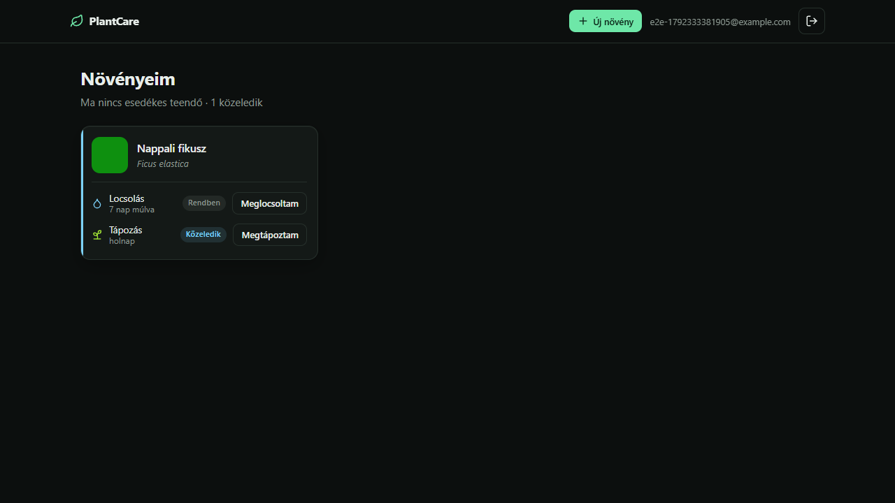
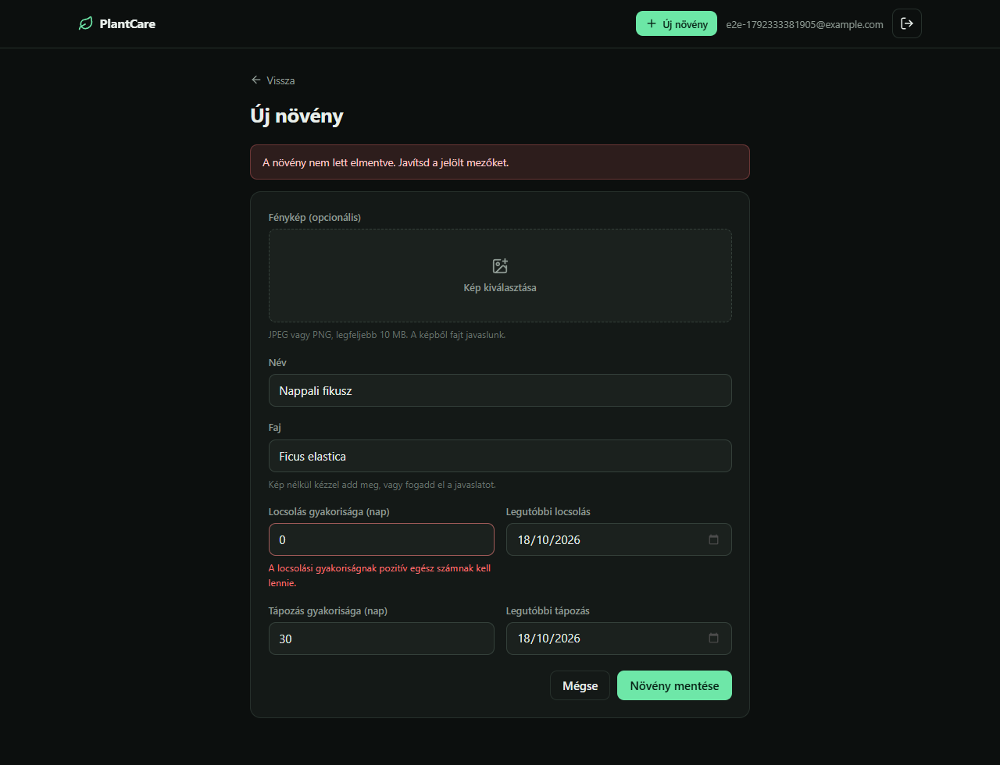

# PlantCare 🌿

*Szoftverfejlesztés MI támogatással* házi feladat


## Dokumentáció
| | |
|---|---|
| [SPECIFICATION.md](SPECIFICATION.md) | cél, szerepkör, forgatókönyv, **AC1–AC8**, bizonytalanságok, változásnapló |
| [docs/TESTING.md](docs/TESTING.md) | tesztszintek, **AC → teszt mátrix**, kézi ellenőrzések, legutóbbi futás |
| [docs/BUG_DEMO.md](docs/BUG_DEMO.md) | a teszt a hibás változaton elbukik, a javítotton átmegy |
| [docs/AI_USAGE.md](docs/AI_USAGE.md) | MI-eszköz, munkamódszer, **3 döntési eset**, korlátok |
| [docs/CHANGE_REQUEST.md](docs/CHANGE_REQUEST.md) | változtatási igény (3. mérföldkő) |
| [AGENTS.md](AGENTS.md), [.claude/](.claude) | MI-ügynököknek szóló szabályok, skillek, ügynökök |

## Funkciók
| Funkció | AC |
|---|---|
| Regisztráció, bejelentkezés (JWT), mezőnkénti hibaüzenetek | AC1 |
| Növény felvétele: név, faj, locsolási/tápozási gyakoriság, legutóbbi dátumok, opcionális fotó | AC2, AC5 |
| Lista esedékesség szerint: **Lejárt / Esedékes / Közeledik (≤2 nap) / Rendben** | AC3 |
| „Meglocsoltam” / „Megtápoztam”: esemény rögzítése, új esedékesség, előzmények | AC4 |
| Fajjavaslat fotóból (Pl@ntNet): elfogadható vagy átírható | AC6 |
| Fejlődési képek feltöltése és visszanézése időrendben | AC7 |
| Növény törlése megerősítéssel, az összes kapcsolódó adattal együtt | AC8 |

Csak a saját növények láthatók; más felhasználó növényére minden végpont 404-et ad.

## Technológia és felépítés
```
┌──────────────────────┐   /api (Vite proxy)   ┌────────────────────────────┐        ┌──────────────┐
│ React 19 + TS (Vite) │ ───────────────────▶ │ ASP.NET Core Web API (.NET10)│ ─EF──▶ │ PostgreSQL 17│
│ sötét, minimalista UI│ ◀─────── JSON ─────── │ JWT, validáció, CareSchedule │        └──────────────┘
└──────────────────────┘                       │  └─ Pl@ntNet kliens ─────────┼──▶ my-api.plantnet.org
                                               └────────────────────────────┘
```
- **Backend** (`backend/src/PlantCare.Api`): kontrollerek, `Domain/CareSchedule` (esedékességi szabályok), `Validation/`
  (magyar hibaüzenetek), `Recognition/` (Pl@ntNet), EF Core migrációk. A képek a PostgreSQL-ben vannak (`bytea`),
  a törlés `ON DELETE CASCADE`-del viszi őket.
- **Frontend** (`frontend/src`): `pages/` (bejelentkezés, lista, új növény, részletek), `components/`, `api/`.
- **Tesztek**: xUnit unit és integráció (Testcontainers PostgreSQL), Vitest + Testing Library, Playwright E2E.

## Indítás
**Előfeltételek:** .NET SDK 10, Node.js 24 (npm), Docker Desktop. Az E2E teszthez telepített Google Chrome.

```bash
# 1. Adatbázis (PostgreSQL a 5433-as porton, hogy ne ütközzön egy helyi 5432-vel)
docker compose up -d

# 2. Backend – http://localhost:5080 (induláskor lefuttatja a migrációkat)
dotnet run --project backend/src/PlantCare.Api --launch-profile http

# 3. Frontend – http://localhost:5173
cd frontend
npm install
npm run dev
```
Nyisd meg a http://localhost:5173 címet, és regisztrálj.

### Pl@ntNet API kulcs (növényfelismeréshez)
1. Regisztrálj a https://my.plantnet.org oldalon, és másold ki az API kulcsot (ingyenes, napi 500 felismerés).
2. Állítsd be (nem kerül a repóba):
   ```bash
   dotnet user-secrets set "PlantNet:ApiKey" "<kulcs>" --project backend/src/PlantCare.Api
   ```
   vagy környezeti változóként: `PlantNet__ApiKey=<kulcs>`.

Kulcs nélkül minden más működik; a felismerés helyén ez az üzenet jelenik meg: „A növényfelismerés jelenleg nem
érhető el, add meg a fajt kézzel.”

### Konfiguráció
| Kulcs | Alapérték | Megjegyzés |
|---|---|---|
| `ConnectionStrings:PlantCare` | `Host=localhost;Port=5433;…` | lásd `appsettings.json` |
| `Jwt:Key` | csak Developmentben van megadva | élesben környezeti változóból (`Jwt__Key`), min. 32 karakter |
| `App:TimeZone` | `Europe/Budapest` | ez határozza meg a „mai napot” |
| `PlantNet:ApiKey` | üres | user-secrets / környezeti változó |

## Tesztek
```bash
dotnet test backend                       # 91 teszt: unit + integráció (Docker kell)
dotnet test backend --filter "AC=AC3"     # egy elfogadási feltétel tesztjei
cd frontend
npm test                                  # 14 Vitest teszt
npm run lint && npm run build
npm run e2e                               # Playwright, a DB fusson (docker compose up -d)
```
Részletek, AC-mátrix és a legutóbbi eredmények: [docs/TESTING.md](docs/TESTING.md).

## Mérföldkövek
| Mérföldkő | Állapot |
|---|---|
| 1. Specifikáció | beadva (PDF); számozott, pontosított változat: [SPECIFICATION.md](SPECIFICATION.md) |
| 2. Első működő verzió | kész – git tag: `v1.0` |
| 3. Végleges verzió (változtatási igény) | az oktatói igényre vár – [docs/CHANGE_REQUEST.md](docs/CHANGE_REQUEST.md) |

## Képernyőképek
| Lista | Hibás gyakoriság |
|---|---|
|  |  |
